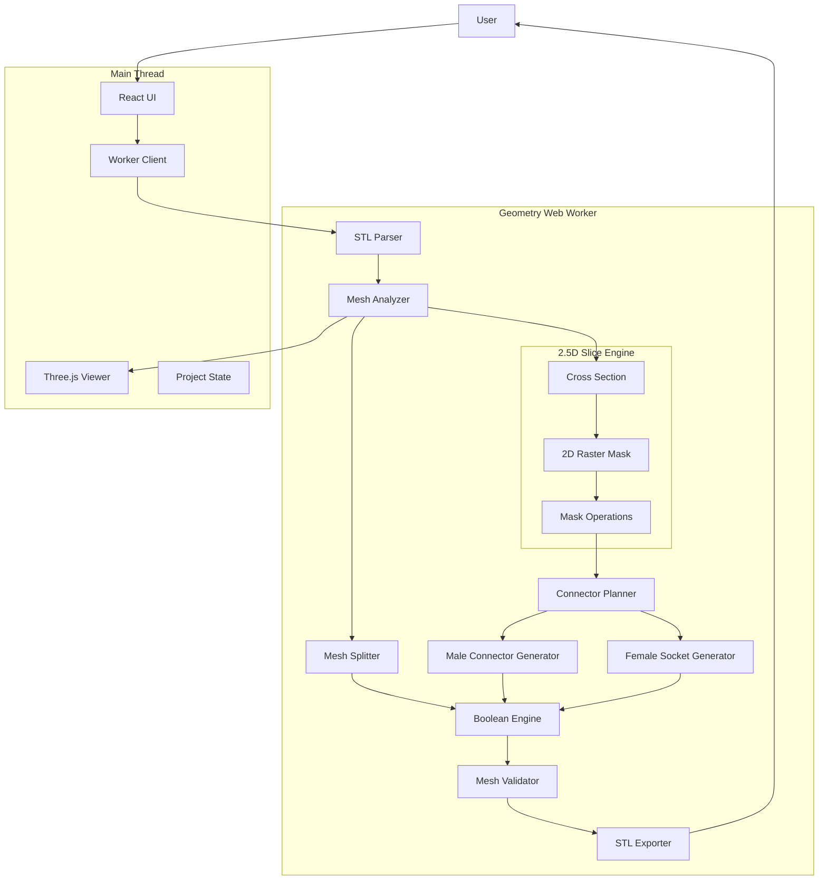
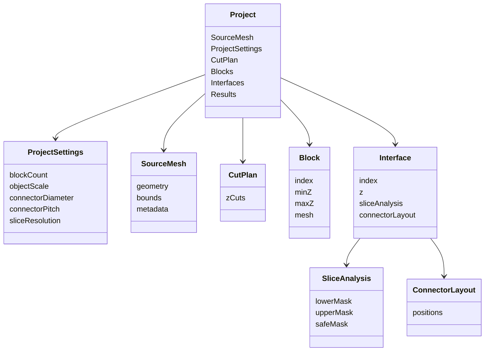
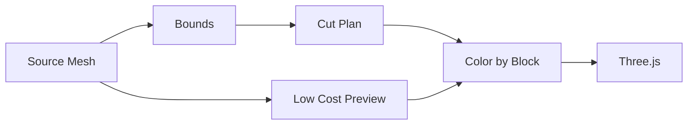
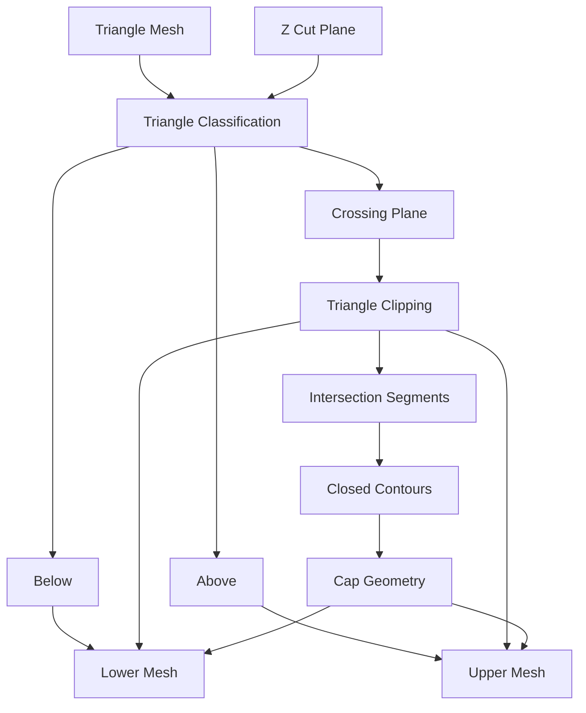
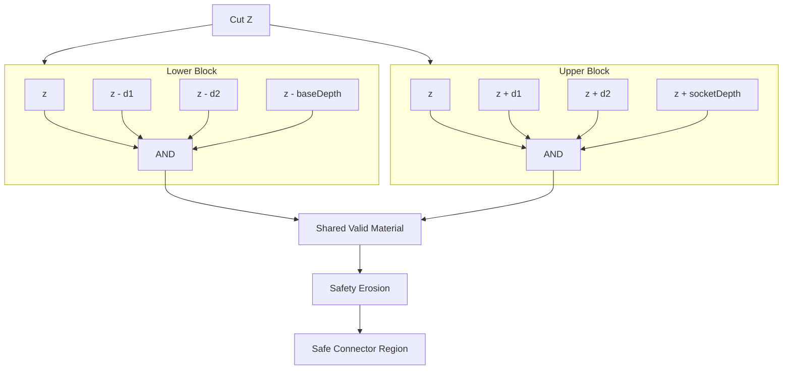
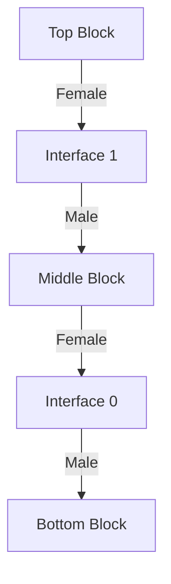
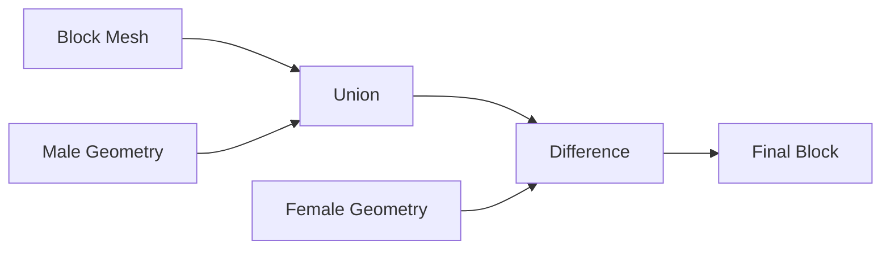
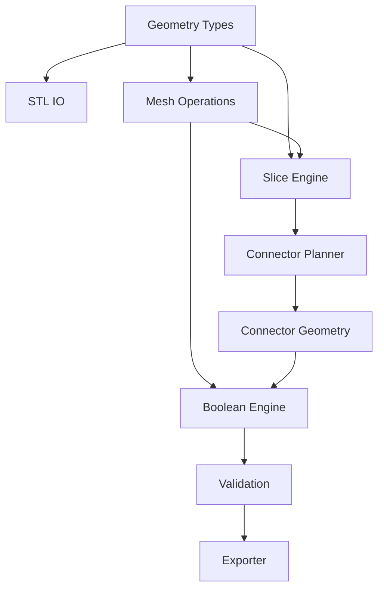
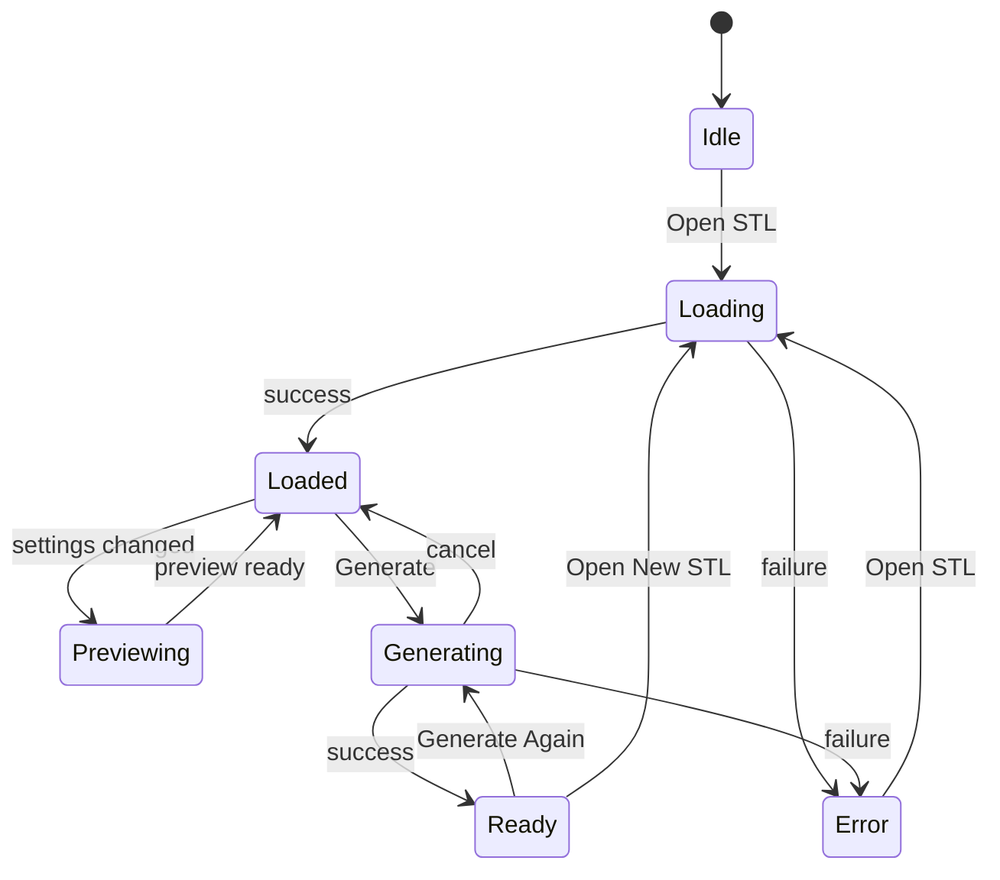
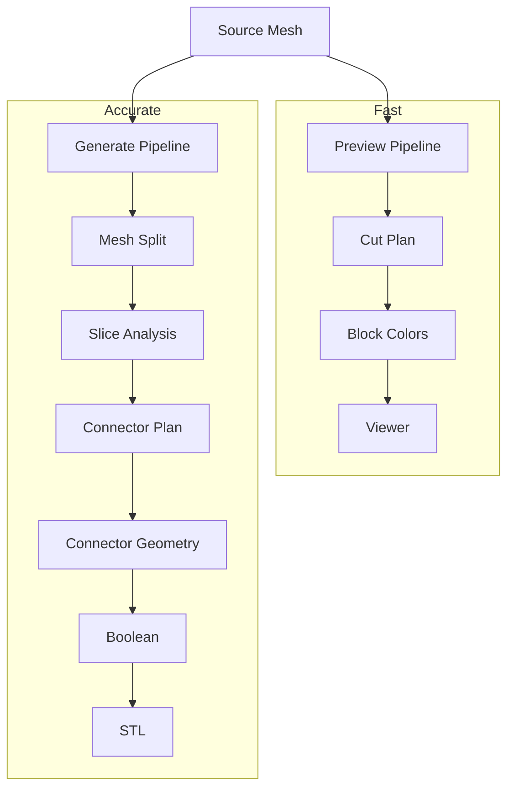

# BlocksTL

## STL Building Blocks Web App — 개발 인수인계 명세

## 1. 프로젝트 목표

기존 데스크톱 프로그램 **Amazing Toys Creator: Building Blocks**와 유사한 기능을 웹에서 구현한다.

사용자가 STL 파일을 업로드하면:

1. 모델을 Z축 방향으로 여러 블록으로 분할한다.
2. 각 절단면을 분석한다.
3. 절단면 내부에 규칙적인 connector grid를 배치한다.
4. 아래쪽 블록에는 male pin을 생성한다.
5. 위쪽 블록에는 female socket을 생성한다.
6. 최종적으로 여러 개의 독립 STL 파일을 생성한다.

모든 처리는 사용자 브라우저에서 수행한다.

백엔드는 사용하지 않는다.

### 현재 구현 상태 (2026-08)

이 문서의 초기 설계 및 마일스톤 중 아래 항목은 이미 구현됐다. 이후 작업에서 과거 로드맵 문구를 근거로 기능을 단순 원통 소켓 등으로 되돌리지 않는다.

```text
Manifold WASM 기반 Z 분할 및 Boolean STL 생성
Orthographic point-cloud Cut Preview (Main Thread 최대 160k 표면 점)
Z-up 3D Inspect
Object Scale과 독립적인 고정 mm connector
19/20/21 male-only 핀 보정
Spring Socket V1 (experimental-v1)
socket 전체 깊이 multi-slice footprint 검사
19/20/21 실제 출력용 fit coupon
BLOCK_GENERATED progressive QA
실제 생성 mesh의 top / bottom / side projection
개별 STL 및 ZIP 다운로드
```

현재 Spring Socket 치수는 원본 치수의 확정 복원값이 아니다. `video estimate + print coupon`에서 시작한 실험 프로필이며, 실제 PLA coupon의 삽입력·유격·분리력·반복 내구성 결과가 들어오기 전에는 임의로 V2 치수를 확정하지 않는다.

남은 우선순위:

```text
1. fit coupon 실제 출력 및 결과 기록
2. connector profile experimental-v2 결정
3. 대형 STL generation 메모리/성능 측정
4. non-manifold / multi-shell 입력 안정화
5. Spring topology refinement (출력 데이터가 근거일 때만)
6. 영상 palette 및 Replica UI polish
```

---

## 2. 기본 기술 스택

### Frontend

- Vite
- React
- TypeScript

### 3D Preview

- Three.js

### Heavy Computation

- Web Worker

### Geometry

현재 구현은 `manifold-3d` WASM을 사용한다.

- STL triangle mesh welding
- Z slab intersection
- male pin union
- Spring Socket V1 subtraction/union
- watertight result mesh export

Geometry kernel 교체 가능성은 열어두되, 현재 동작과 테스트는 Manifold WASM을 기준으로 한다.

### Export

- STL
- 필요시 ZIP 패키징

---

## 3. 핵심 설계 원칙

### 모델 전체를 voxelize하지 않는다

전체 3D volume voxelization은 사용하지 않는다.

모델 자체는 끝까지 Triangle Mesh 상태를 유지한다.

```text
Original STL
    ↓
Triangle Mesh
    ↓
Mesh Split / Boolean
    ↓
Result Triangle Mesh
    ↓
STL
```

Voxel 또는 raster grid는 전체 모델 형상 생성에 사용하지 않는다. 현재 connector 위치 판정은 Manifold의 여러 Z slice에서 얻은 2D polygon loop와 실제 spring-cell 직사각형 footprint containment를 사용한다.

```text
Cut Plane
    ↓
2D Cross Section
    ↓
2D Polygon Loops
    ↓
Connector Placement
```

즉 전체 구조는:

```text
3D Mesh + 2.5D Slice Analysis
```

방식이다.

---

## 4. 전체 시스템 구조



---

## 5. Main Thread 역할

Main Thread는 geometry 계산을 직접 수행하지 않는다.

담당:

- 파일 선택
- UI
- 설정 관리
- Three.js preview
- progress 표시
- Worker 통신
- 결과 다운로드

하지 말아야 할 것:

- STL 대규모 parsing
- triangle clipping
- slicing
- connector 탐색
- Boolean
- STL 생성

이 작업들은 모두 Worker에서 처리한다.

---

## 6. Worker 역할

Geometry Worker는 실제 계산을 담당한다.

주요 책임:

```text
STL parse

Mesh analysis

Cut plane 계산

Mesh splitting

Cross section 생성

2D mask 생성

Connector 위치 탐색

Connector geometry 생성

Boolean

Mesh validation

STL export
```

---

## 7. Project 모델

프로젝트의 핵심 데이터 관계는 다음 구조를 따른다.



핵심 개념:

```text
Block
```

과

```text
Interface
```

를 분리한다.

Connector는 Block이 아니라 Interface에 속한다.

예:

```text
Block 0
   │
Interface 0
   │
Block 1
   │
Interface 1
   │
Block 2
```

---

## 8. Cut Plan

기본 버전에서는 모델의 Z bounding range를 균등 분할한다.

예:

```text
blockCount = 3

Zmax
 │
 │ Block 2
 │
 ───────── Cut 1
 │
 │ Block 1
 │
 ───────── Cut 0
 │
 │ Block 0
 │
Zmin
```

초기 버전에서는 adaptive slicing 또는 최적 cut 위치 탐색을 구현하지 않는다.

향후 확장 기능으로 둔다.

---

## 9. Preview Pipeline

Preview는 실제 geometry 생성과 분리한다.

설정이 변경될 때마다 Boolean을 돌리면 안 된다.

Preview는 빠르게 동작해야 한다.



사용자가:

```text
blockCount
```

를 변경하면:

```text
Cut Plane 위치
Block 색상
```

만 즉시 업데이트한다.

---

## 10. Mesh Split Pipeline

실제 Generate 단계에서만 수행한다.



중요:

Mesh split과 cross-section 계산은 가능하면 같은 절단 정보를 공유하도록 설계한다.

---

## 11. 절단면 Cross Section

Z plane과 mesh triangle의 교차를 계산한다.

결과는 여러 line segment이다.

```text
Triangle
   ↓
Plane intersection
   ↓
Line segments
   ↓
Segment stitching
   ↓
Closed polygon loops
```

하나의 절단면에는 여러 contour가 존재할 수 있다.

예:

```text
Outer contour

+----------------------+
|                      |
|    +-----------+     |
|    |   hole    |     |
|    +-----------+     |
|                      |
+----------------------+
```

따라서:

- outer loop
- inner hole loop
- disconnected islands

모두 지원할 수 있게 데이터 구조를 잡는다.

---

## 12. 2.5D Slice Analysis

Connector 배치를 위해 cut plane 하나만 검사하지 않는다.

Connector가 들어가는 깊이만큼 위/아래 인접 슬라이스를 분석한다.



이 방식의 목적:

절단면에서는 넓지만 조금만 위/아래로 이동하면 얇아지는 영역에 connector가 배치되는 것을 방지한다.

---

## 13. 2D Mask

Cross Section polygon을 2D raster mask로 변환한다.

예:

```text
0000000000
0011111000
0111111100
0111111100
0011111000
0000000000
```

Mask는 connector 위치 판단용이다.

실제 STL surface를 만들기 위한 geometry 표현이 아니다.

권장 초기 해상도:

```text
0.1 ~ 0.25 mm / pixel
```

실제 값은 테스트 후 결정한다.

---

## 14. Mask 연산

필요한 주요 연산:

```text
AND

EROSION

CONTAINS

DISTANCE TO EDGE
```

가능하면 초기 구현은 단순하게 유지한다.

핵심:

```text
safeMask
=
intersection(all required slices)
```

이후:

```text
safeMask
=
erode(
    safeMask,
    connectorRadius + safetyMargin
)
```

---

## 15. Connector Grid

Connector는 불규칙하게 배치하지 않는다.

고정 XY lattice를 사용한다.

개념:

```text
●   ●   ●   ●

●   ●   ●   ●

●   ●   ●   ●
```

각 grid point에 대해:

```text
safeMask 내부인가?
```

를 확인한다.

가능한 경우 connector로 채택한다.

---

## 16. Grid Origin

현재 원본 프로그램의 정확한 grid origin 규칙은 확정되지 않았다.

후보:

1. Bounding Box 중심 기준
2. Bounding Box min 기준
3. World origin 기준

초기 구현에서는:

```text
Bounding Box Center 기준
```

을 추천한다.

그러나 별도 모듈로 분리하여 변경 가능하게 만든다.

---

## 17. Connector Planner

Connector Planner는 geometry를 생성하지 않는다.

책임은 오직:

```text
어디에 connector를 생성할 것인가
```

를 결정하는 것이다.

입력:

```text
Interface

Safe Mask

Grid Configuration

Connector Configuration
```

출력:

```text
Connector Positions
```

각 위치:

```text
x
y
z
orientation
```

---

## 18. Connector Generator

Connector Planner 결과를 실제 geometry로 변환한다.

두 종류:

```text
Male Connector

Female Connector
```

현재 구현:

Male:

```text
5 mm tapered male pin + root collar
```

Female:

```text
Spring Socket V1 compliant cell
```

19/20/21 단계는 male 지름만 5.8/5.9/6.0 mm로 바꾸며 female geometry는 고정한다.

---

## 19. Spring Socket

원본 프로그램의 핵심 구조를 근사한 첫 구현이 완료됐다.

현재 상태:

```text
Spring Socket V1 — experimental-v1
```

로 추가한다.

목표:

```text
Compliant spring structure
```

를 사용하여 출력 공차에 대한 허용도를 확보한다. 다만 실제 출력 성능은 아직 coupon으로 검증해야 한다.

Socket geometry는 반드시 별도 모듈이어야 한다.

```text
SpringSocketGenerator
```

처럼 교체할 수 있게 설계한다.

---

## 20. Block Connector 방향

기본 규칙:

```text
Top Block

bottom = female
```

중간 블록:

```text
top = male

bottom = female
```

Bottom Block:

```text
top = male
```

예:



---

## 21. Boolean Stage

Mesh Split으로 만들어진 block에 connector geometry를 적용한다.

Male:

```text
Block UNION Male Pin
```

Female:

```text
Block DIFFERENCE Female Socket
```

구조:



Boolean 엔진은 인터페이스로 감싼다.

특정 라이브러리가 앱 전체에 노출되지 않도록 한다.

---

## 22. Geometry Engine 계층



의존 방향을 가능한 한 한 방향으로 유지한다.

---

## 23. Worker Protocol

Main → Worker:

```text
LOAD_STL

UPDATE_SETTINGS

GENERATE_PREVIEW

GENERATE_BLOCKS

CANCEL

DISPOSE
```

Worker → Main:

```text
STL_LOADED

PREVIEW_READY

PROGRESS

WARNING

ERROR

GENERATION_COMPLETE
```

큰 TypedArray는 가능한 Transferable을 사용한다.

불필요한 복사를 피한다.

---

## 24. App State



---

## 25. UI 구조

원본 프로그램과 비슷하게 단순하게 유지한다.

```text
┌──────────────────────────────────────────────┐
│ Building Blocks                             │
│ Split STL into interlocking blocks          │
├───────────────────┬──────────────────────────┤
│                   │                          │
│ Open STL          │                          │
│                   │                          │
│ Number of blocks  │                          │
│                   │        Preview           │
│ Pin diameter      │                          │
│                   │                          │
│ Object scale      │                          │
│                   │                          │
│ Generate          │                          │
│                   │                          │
│ Status            │                          │
│                   │                          │
└───────────────────┴──────────────────────────┘
```

첫 번째 버전에서는 UI 디자인보다 geometry pipeline 검증을 우선한다.

---

## 26. 개발 단계

### M1 — Foundation

목표:

```text
Vite
React
TypeScript
Three.js
Web Worker
```

기본 구조 구축.

기능:

```text
STL load

Mesh preview

Bounding box

blockCount 설정

Z cut preview
```

---

### M2 — Exact Z Mesh Split

구현:

```text
Triangle / plane classification

Triangle clipping

Intersection segment 생성

Contour 연결

Cap 생성

N block split
```

완료 조건:

```text
Cube

Cylinder

Simple concave object
```

를 나눴을 때 각 block이 watertight mesh가 되어야 한다.

---

### M3 — 2D Cross Section

구현:

```text
Z plane slicing

Segment stitching

Polygon loop 생성

Hole / island 처리
```

---

### M4 — Raster Mask

구현:

```text
Polygon → Binary Mask

Multiple nearby slices

Mask AND

Erosion
```

결과:

```text
Safe Connector Region
```

---

### M5 — Connector Planner

구현:

```text
Fixed XY grid

Safe mask validation

Edge margin

Connector position list
```

Preview에서 connector 후보 위치를 확인할 수 있어야 한다.

---

### M6 — Basic Connector Geometry (완료)

구현:

```text
Male tapered pin

Female Spring Socket V1
```

Spring 형상은 구현됐으며 `experimental-v1`으로 취급한다.

---

### M7 — Boolean

Connector를 실제 block mesh에 적용한다.

```text
Male = UNION

Female = DIFFERENCE
```

---

### M8 — STL Export

각 block을 개별 STL로 생성한다.

예:

```text
model_block_01.stl

model_block_02.stl

model_block_03.stl
```

선택적으로 ZIP 생성.

---

### M9 — Spring Socket V1 (구현 완료, 물리 검증 대기)

compliant female connector의 가설형 V1을 구현했다. 다음 변경은 실제 fit coupon 결과를 근거로 한다.

필요한 parameter:

```text
spring thickness

spring length

socket depth

socket clearance

cell width

cell height

preload
```

이 단계는 실제 FDM 출력 테스트와 병행해야 한다.

---

### M10 — Optimization

대형 STL 대응.

주요 작업:

```text
Worker memory 관리

Transferable ArrayBuffer

Triangle spatial indexing

Z bucket

Preview decimation

Progress reporting

Cancel support
```

---

## 27. 테스트용 모델

최소 세 종류를 사용한다.

### Cube

검증:

```text
mesh split

cap

connector grid
```

### Cylinder

검증:

```text
curved boundary

edge margin
```

### Concave Shape

예:

```text
L shaped prism
```

검증:

```text
concave contour

cap triangulation

mask generation
```

추후 복잡한 character STL을 추가한다.

---

## 28. 주요 Validation

최종 block에 대해 확인:

```text
NaN vertex 없음

degenerate triangle 없음

boundary edge 없음

non-manifold edge 없음

orientation 정상

bounding box 정상
```

가능하면:

```text
모든 edge incidence == 2
```

를 기본 watertight 검사로 활용한다.

---

## 29. 성능 원칙

절대 하지 말 것:

```text
Full 3D voxelization

Main Thread geometry

설정 변경마다 full Boolean

대형 ArrayBuffer 반복 복사
```

권장:

```text
Triangle mesh 유지

2D mask 사용

Web Worker

Transferable buffers

Preview / Generate pipeline 분리
```

---

## 30. Preview와 Generate 분리



Preview는 가볍게.

Generate는 정확하게.

---

## 31. 현재 확정 사항

확정:

```text
Vite SPA

No Backend

React + TypeScript

Three.js Preview

Web Worker Geometry

Triangle Mesh 기반

2.5D slice mask

Z-axis horizontal split

Fixed connector grid

Male / Female connector

STL export
```

---

## 32. 아직 확정하지 말아야 하는 사항

구현 과정에서 테스트 후 선택:

```text
Boolean library

STL parser implementation

Mesh data structure

Contour stitching algorithm

Polygon triangulation library

2D mask resolution

Grid origin rule

Connector pitch

Connector real dimensions

Spring socket geometry
```

특히 특정 Boolean library에 너무 일찍 시스템 전체를 종속시키지 않는다.

---

## 33. MVP 완료 정의

아래 시나리오가 동작하면 MVP 완성이다.

```text
1. 웹사이트 접속

2. STL 열기

3. 3D 모델 표시

4. blockCount = 3 선택

5. 3개 Z 영역 표시

6. Generate

7. 모델을 실제 3개 mesh로 분할

8. 두 interface 분석

9. connector grid 생성

10. male/female 기본 connector 생성

11. Boolean 적용

12. 3개의 watertight STL 생성

13. 다운로드
```

Spring Socket V1과 fit coupon까지 구현됐다. MVP 이후 남은 단계는 실제 출력 보정과 topology refinement다.

---

## 34. 절대적인 우선순위

```text
1. Mesh correctness

2. Watertight split

3. Reliable slice analysis

4. Connector placement

5. Boolean reliability

6. Performance

7. UI polish

8. Spring connector 실제 출력 검증 및 V2 보정
```

UI보다 geometry correctness를 먼저 해결한다.

---

## 35. 코딩 AI에게 요구할 개발 방식

한 번에 전체 앱을 구현하지 않는다.

각 milestone을 독립적으로 구현하고 검증한다.

순서:

```text
M1
 ↓
test
 ↓
M2
 ↓
test
 ↓
M3
 ↓
test
 ↓
...
```

각 단계에서:

```text
기존 모듈의 책임을 불필요하게 변경하지 않는다.

geometry와 UI를 강하게 결합하지 않는다.

순수 geometry 함수는 React / Three.js 의존성을 최소화한다.

Web Worker 경계를 유지한다.

큰 TypedArray의 불필요한 복사를 피한다.

전체 volume voxelization을 도입하지 않는다.
```

---

# 최종 아키텍처 요약

```text
                     Vite + React
                          │
                ┌─────────┴─────────┐
                │                   │
           Three.js Viewer     Worker Client
                                    │
                                    ▼
                            Geometry Web Worker
                                    │
                 ┌──────────────────┼───────────────────┐
                 │                  │                   │
             Mesh Engine       2.5D Engine        Connector Engine
                 │                  │                   │
             Z Split          Slice / Mask        Layout / Geometry
                 │                  │                   │
                 └──────────────────┼───────────────────┘
                                    │
                              Boolean Engine
                                    │
                              Mesh Validation
                                    │
                                STL Export
```

이 구조를 프로젝트의 기본 설계로 유지한다.
